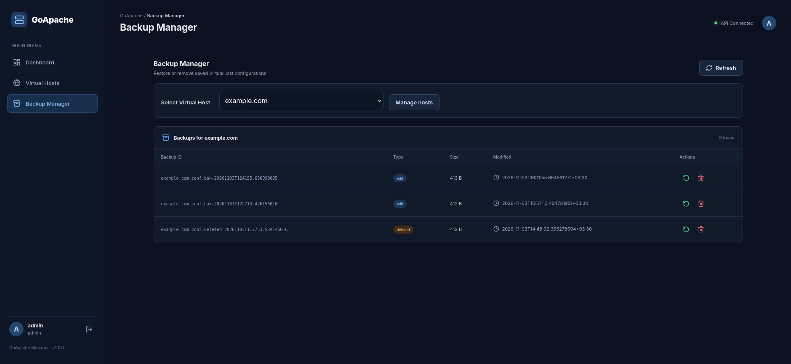

# GoApache Manager


**A secure, self-hosted web dashboard for managing Apache HTTP Server and VirtualHosts on Linux.**

Manage Apache VirtualHosts, monitor services, validate configurations, and manage backups through a modern web interface — without manually editing configuration files or running Apache commands.

GoApache Manager is an open-source Apache administration panel built with Go, React, and TypeScript. It is designed for Linux server administrators, developers, hosting providers, and anyone who wants a simpler way to manage Apache HTTP Server.

Instead of giving the web application unrestricted root privileges, GoApache Manager uses a separate privileged helper process that performs authorized system operations through a restricted Unix socket.

**No external management port needs to be exposed:** the frontend is served by Apache, while the Go backend listens on `127.0.0.1:9090` and receives API requests through Apache's reverse proxy.

---

## Screenshots



*GoApache Manager web dashboard.*

> More screenshots and interface previews will be added as the project evolves.

---

## Key Features

### VirtualHost Management

- List Apache VirtualHosts, including managed and external configurations.
- Create new managed VirtualHosts through the web interface.
- Automatically create the corresponding web root directory.
- Generate Apache VirtualHost configuration files.
- Enable and disable managed VirtualHosts.
- Edit DocumentRoot and ServerAliases.
- Delete managed VirtualHost configurations.
- Preserve DocumentRoot directories when deleting a VirtualHost.
- Automatically back up configurations before operations that modify or replace them.
- Display the source configuration file for each VirtualHost.
- Protect external configurations from accidental modification.

### Apache Service Management

- View Apache service status.
- Run Apache configuration tests using `apache2ctl -t`.
- Reload Apache after configuration changes.
- Restart Apache through the dashboard.
- Display command output and operation errors.

### Backup Management

- Automatically create configuration backups before supported modifications.
- List available backups.
- Restore previous configurations.
- Create safety backups before restoring an older version.
- Delete individual backup files.
- Validate Apache configuration before applying restored changes.
- Roll back failed configuration operations where supported.

### Security

- Username/password authentication.
- bcrypt password hashing.
- Server-side session management.
- HttpOnly, Secure, and SameSite session cookies.
- CSRF protection for state-changing requests.
- Separate root-privileged helper process.
- Unix domain socket communication.
- Peer credential verification using `SO_PEERCRED`.
- Restricted helper socket permissions (`0660`, `root:goapache`).
- External VirtualHosts are read-only.
- DocumentRoot path validation.
- Symlink rejection for managed DocumentRoot changes.
- Apache configuration validation before applying changes.
- Automatic rollback when supported operations fail.

---

## Quick Start

**Get started with a prebuilt release. No Go, Node.js, npm, or compiler is required.**

### 1. Download the latest release

Go to the GitHub Releases page:

[**Download GoApache Manager**](https://github.com/destan0098/goapache-manager/releases)

For Linux AMD64, download:

`goapache-manager-linux-amd64.tar.gz`

### 2. Extract the package

```bash
tar -xzf goapache-manager-linux-amd64.tar.gz

cd goapache-manager-linux-amd64
```

### 3. Run the installer

```bash
sudo bash scripts/install.sh
```

The interactive installer guides you through panel domain configuration and administrator account creation.

### 4. Open the panel

After installation, open the panel URL displayed by the installer.

Create or use the administrator account configured during installation.

**Important:** For production and public access, configure HTTPS before logging in.

### Verify the downloaded package

The release includes a SHA256 checksum file.

Download both files and run:

```bash
sha256sum -c goapache-manager-linux-amd64.tar.gz.sha256
```

A successful verification displays:

```text
goapache-manager-linux-amd64.tar.gz: OK
```

---

## Supported Platforms

| Platform | Status |
|---|---|
| Ubuntu | Supported |
| Debian | Supported |
| Linux Mint | Supported |
| CentOS / RHEL | Not supported yet |
| Rocky Linux / AlmaLinux | Not supported yet |
| Other distributions | Not supported yet |

The current implementation uses the Debian/Ubuntu Apache directory structure:

- `/etc/apache2/`
- `/etc/apache2/sites-available/`
- `/etc/apache2/sites-enabled/`

The prebuilt release currently targets:

| Property | Value |
|---|---|
| Operating System | Linux |
| Architecture | AMD64 / x86_64 |
| Apache | 2.4 |
| Backend | Go |
| Frontend | React + TypeScript |
| Database | SQLite |

---

## Requirements

### For prebuilt releases

You need:

- Linux AMD64 (x86_64).
- Debian, Ubuntu, or Linux Mint.
- Apache HTTP Server 2.4.
- Root or sudo access.
- systemd.

Install Apache if it is not already installed:

```bash
sudo apt update
sudo apt install -y apache2
```

### For building from source

If you want to compile the project yourself, you also need:

- Go 1.26 or later: https://go.dev/dl/
- Node.js 22 or later: https://nodejs.org/
- npm.
- Git.
- GCC and build tools.

Install the system dependencies:

```bash
sudo apt update

sudo apt install -y \
    apache2 \
    git \
    build-essential \
    curl \
    ca-certificates
```

Verify the installed tools:

```bash
go version
node --version
npm --version
apache2ctl -v
```

The Go SQLite driver uses CGO, so a working C compiler is required when building the backend.

---

## Installation

There are two installation methods:

1. Install a prebuilt release — recommended for most users.
2. Build and install from source — recommended for developers and contributors.

### Method 1 — Prebuilt Release

Download the latest release from:

https://github.com/destan0098/goapache-manager/releases

Extract the archive:

```bash
tar -xzf goapache-manager-linux-amd64.tar.gz

cd goapache-manager-linux-amd64
```

Run the installer:

```bash
sudo bash scripts/install.sh
```

The installer handles the application binaries, frontend files, system users, systemd services, Apache integration, and administrator setup.

No Go or Node.js installation is necessary for this method.

### Method 2 — Build from Source

#### Step 1 — Clone the repository

```bash
git clone https://github.com/destan0098/goapache-manager.git

cd goapache-manager
```

#### Step 2 — Build the backend

```bash
go build -o goapache ./cmd/server
```

#### Step 3 — Build the privileged helper

```bash
go build -o goapache-helper ./cmd/helper
```

Both binaries must exist in the repository root because the installer expects them there.

#### Step 4 — Build the frontend

```bash
cd frontend

npm ci

npm run build

cd ..
```

This generates the static frontend in:

```text
frontend/dist/
```

#### Step 5 — Run the installer

```bash
sudo bash scripts/install.sh
```

The installer locates the project directory automatically.

---

## Automated Release Build

The repository includes an automated release build script:

```bash
./scripts/build-release.sh
```

The script:

1. Checks the required build dependencies.
2. Builds the Go backend.
3. Builds the privileged helper.
4. Installs frontend dependencies using `npm ci`.
5. Builds the React frontend.
6. Prepares the release directory.
7. Copies the installer and systemd service files.
8. Generates release metadata.
9. Creates a compressed `.tar.gz` archive.
10. Generates a SHA256 checksum.

The generated files are placed in:

```text
dist/
```

For example:

```text
dist/
├── goapache-manager-linux-amd64.tar.gz
└── goapache-manager-linux-amd64.tar.gz.sha256
```

To specify a release version:

```bash
VERSION=1.1.0 ./scripts/build-release.sh
```

**Note:** The current release build script targets Linux AMD64 and requires CGO with GCC.

---

## What the Installer Does

The installer is located at:

```text
scripts/install.sh
```

It performs the following operations:

1. Checks that the operating system is supported.
2. Verifies that Apache and the required application build files exist.
3. Creates a dedicated `goapache` system user and group with a non-login shell.
4. Creates application directories.
5. Installs the backend and helper binaries.
6. Creates the application configuration file if it does not already exist.
7. Installs the systemd service units.
8. Enables and starts the privileged helper.
9. Waits for the helper Unix socket to become available.
10. Starts the backend service.
11. Publishes the frontend build to `/var/www/goapache`.
12. Enables Apache `proxy` and `proxy_http` modules.
13. Configures the panel VirtualHost when a domain is provided.
14. Runs Apache configuration validation before reloading Apache.
15. Checks backend health and helper availability.
16. Offers to create the administrator account.

### Installed Directories

| Path | Purpose |
|---|---|
| `/opt/goapache/` | Application binaries |
| `/etc/goapache/` | Application configuration |
| `/var/lib/goapache/` | SQLite database and application data |
| `/var/lib/goapache/backups/` | Reserved backup directory |
| `/var/log/goapache/` | Application logs |
| `/var/www/goapache/` | Frontend static files |
| `/run/goapache/` | Helper runtime directory |
| `/run/goapache/helper.sock` | Privileged helper Unix socket |

### Systemd Services

Two services are installed:

| Service | Runs as | Purpose |
|---|---|---|
| `goapache.service` | `goapache` | Web backend and API |
| `goapache-helper.service` | `root` | Privileged Apache operations |

Check their status:

```bash
sudo systemctl status goapache
sudo systemctl status goapache-helper
```

### Installer Domain Configuration

During an interactive installation, the installer asks for a panel domain.

The default is:

```text
goapache.test
```

Press Enter to use the default local domain.

For a public domain, enter a domain such as:

```text
panel.example.com
```

You can also skip panel VirtualHost configuration by entering:

```text
skip
```

When using a local domain, the installer configures local hostname resolution and allows the insecure-cookie mode required for local HTTP access.

For a public domain, configure HTTPS before using the login page.

### Non-interactive Installation

For automated installations, use environment variables:

```bash
sudo PANEL_DOMAIN=panel.example.com bash scripts/install.sh
```

To skip Apache VirtualHost configuration and administrator creation:

```bash
sudo PANEL_DOMAIN=skip SKIP_ADMIN=1 bash scripts/install.sh
```

To use the default local domain explicitly:

```bash
sudo PANEL_DOMAIN=goapache.test bash scripts/install.sh
```

### Important Installer Notes

- The installer does not create default administrator credentials.
- Existing application data and database files are preserved.
- Existing application configuration is not overwritten when it already exists.
- A pre-existing GoApache Apache VirtualHost configuration is backed up before replacement.
- Apache configuration is tested before reloading.
- The panel VirtualHost itself is not managed by GoApache Manager.
- Running the installer again reinstalls binaries and frontend files and restarts services. Review the selected domain and system configuration before rerunning it.

### Create an Administrator Account Manually

If you skipped administrator creation during installation:

```bash
sudo -u goapache /opt/goapache/goapache --create-admin
```

The application prompts for a username and password.

Username requirements:

- 3–64 characters.

Password requirements:

- Use a strong password.
- bcrypt input is limited to 72 bytes.

Run the command as the `goapache` user so the database retains the correct ownership.

---

## HTTPS Configuration

**HTTPS is strongly recommended and should be used for any public deployment.**

GoApache Manager uses Secure session cookies by default. Browsers do not send Secure cookies over ordinary HTTP connections, except for localhost secure-context handling.

For a public deployment, configure a valid TLS certificate before logging in.

### Enable HTTPS with Let's Encrypt

Make sure:

- Your domain points to the server.
- Ports 80 and 443 are reachable.
- Apache is working correctly.

Install Certbot:

```bash
sudo apt update

sudo apt install -y certbot python3-certbot-apache
```

Request a certificate:

```bash
sudo certbot --apache -d panel.example.com
```

Open:

```text
https://panel.example.com
```

Certbot can configure Apache HTTPS and certificate renewal.

### Access Without a Public Domain — SSH Tunnel

If you do not have a domain, you can access the panel through an SSH tunnel.

For example:

```bash
ssh -L 8080:127.0.0.1:80 user@your-server
```

Then open this URL in your local browser:

```text
http://localhost:8080
```

Browsers treat localhost as a secure context, allowing Secure cookies to work.

This assumes the panel VirtualHost is configured on the server's port 80.

### Plain HTTP on a Trusted LAN

If the panel is accessible only on a trusted private network and TLS is unavailable, insecure cookies can be explicitly enabled.

Run:

```bash
sudo systemctl edit goapache
```

Add:

```ini
[Service]
Environment="GOAPACHE_INSECURE_COOKIES=1"
```

Save the override and restart the service:

```bash
sudo systemctl daemon-reload

sudo systemctl restart goapache
```

For a manual backend run:

```bash
GOAPACHE_INSECURE_COOKIES=1 ./goapache
```

**Never enable insecure cookies on a panel exposed to the public internet.**

---

## How It Works

GoApache Manager separates the web application from privileged system operations.

The backend does not run as root. Instead, it communicates with a dedicated root helper over a Unix domain socket.

### Architecture

```text
                  ┌──────────────────────────────────┐
                  │             Browser              │
                  │                                  │
                  │       Web Dashboard (React)      │
                  └────────────────┬─────────────────┘
                                   │
                                   │ HTTPS :443
                                   ▼
                  ┌──────────────────────────────────┐
                  │              Apache              │
                  │                                  │
                  │  /       → Static frontend       │
                  │  /api/*  → 127.0.0.1:9090        │
                  └────────────────┬─────────────────┘
                                   │
                                   │ Loopback only
                                   ▼
                  ┌──────────────────────────────────┐
                  │         goapache backend         │
                  │             User: goapache       │
                  │                                  │
                  │  - Authentication                │
                  │  - Sessions                      │
                  │  - CSRF protection               │
                  │  - JSON API                      │
                  │  - Helper socket client         │
                  └────────────────┬─────────────────┘
                                   │
                                   │ Unix domain socket
                                   │ /run/goapache/helper.sock
                                   ▼
                  ┌──────────────────────────────────┐
                  │        goapache-helper           │
                  │              User: root          │
                  │                                  │
                  │  - Apache configuration changes  │
                  │  - Apache service control        │
                  │  - Backup operations             │
                  │  - Configuration validation      │
                  │  - Rollback operations            │
                  └──────────────────────────────────┘
```

### Application Components

| Component | Location | User | Responsibility |
|---|---|---|---|
| Backend | `/opt/goapache/goapache` | `goapache` | Authentication, sessions, API |
| Helper | `/opt/goapache/goapache-helper` | `root` | Privileged system operations |
| Frontend | `/var/www/goapache/` | Apache | Static React application |
| Database | `/var/lib/goapache/goapache.db` | `goapache` | Application data |

### Why a Separate Helper?

Running the entire web application as root would unnecessarily increase the impact of a potential application vulnerability.

GoApache Manager uses a different approach:

1. The web backend runs under a dedicated unprivileged system account.
2. The helper runs separately with root privileges.
3. The backend communicates with the helper through a Unix domain socket.
4. The helper checks the connecting process credentials using `SO_PEERCRED`.
5. Only connections from the expected `goapache` UID are accepted.
6. The helper performs the supported privileged operations.

This architecture reduces the privileges available to the web-facing backend.

---

## Using the Panel

The dashboard provides the following main sections.

### Dashboard

The Dashboard provides an overview of Apache service status and administrative actions.

Available operations:

- Check whether Apache is running.
- Run Apache configuration tests.
- Reload Apache.
- Restart Apache.
- View operation results and error messages.

The service status is based on the systemd service state.

### Virtual Hosts

The Virtual Hosts section displays Apache VirtualHost configurations.

#### Create

Creating a managed VirtualHost allows you to:

1. Enter a domain name.
2. Create the corresponding directory under `/var/www`.
3. Generate an Apache configuration file.
4. Enable the new VirtualHost.
5. Validate the Apache configuration.
6. Reload Apache after successful validation.

If validation fails, the operation uses rollback where supported.

#### Edit

Managed VirtualHosts support editing:

- DocumentRoot.
- ServerAliases.

DocumentRoot must be an existing real directory inside `/var/www`. Symlinks are rejected.

A backup is created before the configuration is changed.

#### Enable / Disable

Managed VirtualHosts can be enabled or disabled from the interface.

This operation changes the corresponding link under:

```text
/etc/apache2/sites-enabled/
```

#### Delete

Deleting a managed VirtualHost removes its enabled configuration link and moves the configuration file to a timestamped deleted backup.

**The DocumentRoot directory is not deleted.**

#### Managed vs External VirtualHosts

GoApache Manager distinguishes between configurations it owns and configurations created outside the application.

Managed configurations contain this ownership marker on the first line:

```apache
# Managed by GoApache Manager: example.com
```

External configurations:

- Are displayed for visibility.
- Are marked as External.
- Cannot be edited through the application.
- Cannot be enabled, disabled, or deleted through managed-only operations.

This prevents accidental modification of manually maintained Apache configurations.

### Backups

The Backups section provides access to saved Apache configuration versions.

Available operations:

- List backups.
- Restore a previous configuration.
- Delete individual backup files.

Before a restore, a safety copy of the current configuration is created.

Restored configurations are validated before being applied. The enabled/disabled state is preserved where supported.

---

## Configuration

The current release uses a combination of built-in settings and environment variables.

| Setting | Configuration | Description |
|---|---|---|
| Backend address | Hardcoded `127.0.0.1:9090` | Local API listener |
| Database path | `GOAPACHE_DB` | Defaults to `/var/lib/goapache/goapache.db` |
| Cookie Secure mode | `GOAPACHE_INSECURE_COOKIES` | Default uses Secure cookies |
| Session lifetime | Built-in | 1 hour |
| Session cookie | Built-in | HttpOnly, Secure, SameSite=Strict by default |
| Helper socket | Hardcoded | `/run/goapache/helper.sock` |
| Socket permissions | Built-in | `0660`, `root:goapache` |
| Database mode | Built-in | SQLite WAL mode |
| Foreign keys | Built-in | Enabled |
| SQLite busy timeout | Built-in | 5 seconds |
| Application configuration | `/etc/goapache/config.yaml` | Created by installer; not read at runtime in this release |

### Database

GoApache Manager uses SQLite.

Default location:

```text
/var/lib/goapache/goapache.db
```

The database uses:

- Write-Ahead Logging (WAL).
- Foreign key enforcement.
- A 5-second busy timeout.

### Session Cookies

By default, session cookies use:

- HttpOnly.
- Secure.
- SameSite=Strict.

The cookie Secure flag can be changed through:

```text
GOAPACHE_INSECURE_COOKIES
```

Only enable insecure cookies for trusted local or private-network deployments.

### Helper Socket

Default path:

```text
/run/goapache/helper.sock
```

Expected permissions:

```text
srw-rw---- root goapache
```

The helper validates peer credentials in addition to relying on Unix socket filesystem permissions.

### systemd Hardening

The backend service runs under the `goapache` account and uses systemd restrictions, including:

- `NoNewPrivileges`.
- `ProtectSystem=strict`.
- Restricted writable paths for application data and logs.

The helper runs separately as root with its own runtime directory.

---

## Security Considerations

GoApache Manager can modify Apache configurations and control the Apache service. Treat it as a privileged server administration tool.

Before deploying it on a production server, consider the following.

### 1. Always Use HTTPS

Use a valid TLS certificate for public access.

Do not enable:

```text
GOAPACHE_INSECURE_COOKIES=1
```

on an internet-facing deployment.

### 2. Never Expose Port 9090

The backend is designed to listen on:

```text
127.0.0.1:9090
```

Keep it loopback-only.

Do not expose this port through firewall rules, public reverse proxies, or external interfaces.

### 3. Protect the Administrative Interface

Consider restricting panel access using:

- Firewall rules.
- VPN access.
- Apache IP-based access controls.
- Private management networks.

### 4. Understand the Privileged Helper

The helper runs as root.

It communicates through a restricted Unix socket and validates the connecting process credentials.

Nevertheless, granting access to the web panel means granting access to powerful server administration operations.

Only install it on trusted systems and review the code before deployment.

### 5. Protect Apache Configuration Backups

Apache configuration backups are stored alongside the live configuration files.

For example:

```text
/etc/apache2/sites-available/
```

Protect this directory and its contents.

### 6. Use Strong Administrator Credentials

Use a strong, unique password.

The current release does not provide a full user-management interface. Administrator accounts are created through the application command-line interface.

### 7. Keep the Server Updated

Regularly update:

- Linux.
- Apache HTTP Server.
- GoApache Manager.
- Go runtime and build dependencies when building from source.

### 8. Test Before Production

Test configuration changes in a safe environment before applying them to production systems.

GoApache Manager is provided as-is. Administrators are responsible for securing their deployments and reviewing the code before granting administrative access.

---

## Upgrading

Download the latest release from:

https://github.com/destan0098/goapache-manager/releases

For an installation built from source, update the repository:

```bash
cd goapache-manager

git pull
```

Rebuild the backend and helper:

```bash
go build -o goapache ./cmd/server

go build -o goapache-helper ./cmd/helper
```

Rebuild the frontend:

```bash
cd frontend

npm ci

npm run build

cd ..
```

Run the installer without changing the existing panel VirtualHost:

```bash
sudo PANEL_DOMAIN=skip SKIP_ADMIN=1 bash scripts/install.sh
```

For a prebuilt release, extract the new release package and run the installer from the extracted directory:

```bash
sudo PANEL_DOMAIN=skip SKIP_ADMIN=1 bash scripts/install.sh
```

Review the release notes before upgrading.

### Upgrade Notes

The installer preserves existing application data and the database.

It does not overwrite an existing application configuration file.

Using:

```text
PANEL_DOMAIN=skip
```

skips panel VirtualHost configuration, leaving the existing panel VirtualHost untouched.

Always keep a separate backup of important server configuration and database files before upgrading production installations.

---

## Uninstalling

The following commands remove GoApache Manager services and application files.

Stop and disable the services:

```bash
sudo systemctl disable --now goapache goapache-helper
```

Remove the systemd units:

```bash
sudo rm -f /etc/systemd/system/goapache.service

sudo rm -f /etc/systemd/system/goapache-helper.service

sudo systemctl daemon-reload
```

Remove application files:

```bash
sudo rm -rf /opt/goapache

sudo rm -rf /var/www/goapache

sudo rm -rf /etc/goapache
```

Remove the panel VirtualHost if it was created by the installer:

```bash
sudo rm -f /etc/apache2/sites-available/goapache.conf

sudo rm -f /etc/apache2/sites-enabled/goapache.conf
```

Reload Apache:

```bash
sudo apache2ctl configtest

sudo systemctl reload apache2
```

### Optional: Remove Application Data

**Warning:** The following commands permanently delete the application database, backups, and logs.

Only run them if you no longer need this data:

```bash
sudo rm -rf /var/lib/goapache

sudo rm -rf /var/log/goapache
```

Remove the system account and group:

```bash
sudo userdel goapache

sudo groupdel goapache
```

### Existing VirtualHosts

VirtualHosts previously created through GoApache Manager are not automatically deleted during uninstallation.

Review them manually before removing the application.

For example:

```bash
sudo a2dissite example.com

sudo rm /etc/apache2/sites-available/example.com.conf

sudo apache2ctl configtest

sudo systemctl reload apache2
```

Replace `example.com` with the actual VirtualHost name.

---

## Troubleshooting

### 502 Bad Gateway

**Possible cause:** The backend service is not running or Apache cannot reach it.

Check the service:

```bash
sudo systemctl status goapache
```

Inspect logs:

```bash
sudo journalctl -u goapache -n 50 --no-pager
```

Test the API directly:

```bash
curl -i http://127.0.0.1:9090/api/v1/health
```

Expected response:

```json
{"status":"ok"}
```

### Login succeeds but the next request returns 401 Unauthorized

**Possible causes:**

- The browser discarded the Secure session cookie because the panel is accessed over plain HTTP.
- The cookie is not being sent by the browser.
- The session is invalid or expired.

For public deployments, configure HTTPS.

For trusted local HTTP access, use the insecure-cookie option described in the HTTPS section.

### 403 CSRF Validation Failed

**Possible cause:** The CSRF token is missing or outdated.

Try:

1. Reload the page.
2. Log out if possible.
3. Log in again.
4. Retry the operation.

### Helper Connection Refused

Check the helper service:

```bash
sudo systemctl status goapache-helper
```

Inspect its logs:

```bash
sudo journalctl -u goapache-helper -n 50 --no-pager
```

Check the socket:

```bash
ls -l /run/goapache/helper.sock
```

Expected ownership and permissions:

```text
root:goapache
0660
```

### Helper Reports That the goapache User Does Not Exist

The system account may not have been created.

Check:

```bash
id goapache
```

If the installation is incomplete, review the installer output and systemd logs before attempting installation again.

### Apache Configuration Test Failed

Run:

```bash
sudo apache2ctl -t
```

Inspect the reported file and correct the Apache configuration error.

Do not reload Apache until the configuration test succeeds.

### DocumentRoot Rejected

Managed DocumentRoot changes must point to an existing real directory inside:

```text
/var/www/
```

Symlink paths are rejected.

### VirtualHosts Appear but Cannot Be Edited

The configurations are marked as External.

Only configurations containing the GoApache ownership marker can be modified through the application.

### Database Is Locked

Inspect backend logs:

```bash
sudo journalctl -u goapache -n 100 --no-pager
```

Make sure there is no duplicate backend process using the same SQLite database.

### Panel Displays the Wrong Website

Apache may be selecting another VirtualHost for the requested hostname.

Inspect the VirtualHost configuration:

```bash
sudo apache2ctl -S
```

Check that the panel domain resolves to the correct server and that the panel VirtualHost has a unique ServerName.

---

## Frequently Asked Questions

### Does GoApache Manager support CentOS, RHEL, Rocky Linux, or AlmaLinux?

Not yet.

The current implementation relies on the Debian/Ubuntu Apache directory structure:

```text
/etc/apache2/
```

Support for other Apache layouts may be added in future releases.

### Do I need Go and Node.js to install GoApache Manager?

No.

If you use a prebuilt release, Go, Node.js, npm, and a C compiler are not required.

They are needed only when building the application from source.

### Can I change the backend port?

Not in the current release.

The backend listens on:

```text
127.0.0.1:9090
```

Access it through the Apache reverse proxy. Do not expose the backend port publicly.

### Can I manage existing manually created VirtualHosts?

They are displayed in the dashboard but are read-only.

The current release only allows modification of configurations carrying the GoApache ownership marker.

### Does deleting a VirtualHost delete its website files?

No.

Deleting a managed VirtualHost removes or archives its Apache configuration, but the DocumentRoot directory is preserved.

### Where are the backups stored?

Backups are stored next to the corresponding Apache configuration files.

For example:

```text
/etc/apache2/sites-available/example.com.conf.bak-<timestamp>
```

Restore safety copies use timestamped `.restore-` names, while deleted configurations use `.deleted-` names.

The `/var/lib/goapache/backups/` directory is reserved for future use.

### Are there multiple user roles?

The database schema includes `admin`, `operator`, and `viewer` role values.

However, the current API does not enforce complete per-role authorization. Treat every authenticated account as having administrative access in this release.

### Does GoApache Manager automatically configure HTTPS for managed websites?

Not currently.

Managed VirtualHosts are created on port 80.

You can configure HTTPS separately using Certbot or manual Apache configuration.

### Does GoApache Manager expose another public management port?

No.

The backend listens on the loopback interface and Apache proxies API requests to it.

The helper communicates over a local Unix socket.

---

## Technology Stack

| Component | Technology |
|---|---|
| Backend | Go |
| HTTP Router | chi |
| Frontend | React |
| Language | TypeScript |
| Build Tool | Vite |
| UI Icons | Lucide |
| Database | SQLite |
| Database Driver | go-sqlite3 |
| Authentication | bcrypt + server-side sessions |
| Web Server | Apache HTTP Server |
| Process Management | systemd |
| Privileged Operations | Go helper |
| IPC | Unix domain socket |
| Peer Verification | SO_PEERCRED |

---

## Project Structure

```text
goapache-manager/
│
├── cmd/
│   ├── server/             # Web backend
│   └── helper/             # Privileged root helper
│
├── internal/
│   ├── api/                # HTTP API, handlers, middleware
│   ├── apache/             # Apache VirtualHost parsing
│   ├── auth/               # Authentication and sessions
│   ├── database/           # SQLite database and migrations
│   └── helper/             # Helper socket client and protocol
│
├── frontend/               # React + TypeScript application
│   ├── src/
│   └── ...
│
├── packaging/
│   └── systemd/
│       ├── goapache.service
│       └── goapache-helper.service
│
├── scripts/
│   ├── install.sh          # Installation script
│   └── build-release.sh    # Release build automation
│
├── configs/
│   └── config.example.yaml
│
├── screenshot.png
├── go.mod
├── go.sum
├── README.md
└── LICENSE
```

---

## Roadmap

The project is actively evolving.

### Completed

- [x] Go backend and React frontend.
- [x] Separate privileged helper architecture.
- [x] Unix socket communication.
- [x] Peer credential verification.
- [x] Login and server-side sessions.
- [x] CSRF protection.
- [x] Apache service status and controls.
- [x] Apache configuration testing.
- [x] VirtualHost listing.
- [x] Managed and external VirtualHost distinction.
- [x] Create managed VirtualHosts.
- [x] Edit DocumentRoot and ServerAliases.
- [x] Enable and disable managed VirtualHosts.
- [x] Delete managed VirtualHosts while preserving DocumentRoot.
- [x] Configuration backups and restore.
- [x] Configuration validation and rollback support.
- [x] Automated Linux AMD64 release build.
- [x] Installation script.
- [x] Prebuilt GitHub release.

### Planned

- [ ] Configurable backend listen address and port.
- [ ] Runtime application configuration loading.
- [ ] Enforced role-based permissions.
- [ ] User management interface.
- [ ] HTTPS VirtualHost management.
- [ ] Certbot integration.
- [ ] Improved audit logging.
- [ ] More comprehensive automated tests.
- [ ] CI/CD release automation.
- [ ] Additional Linux distribution support.
- [ ] More detailed server resource monitoring.

---

## Contributing

Contributions, bug reports, security feedback, and feature requests are welcome.

If you want to contribute:

1. Fork the repository.
2. Create a feature branch.
3. Implement your changes.
4. Run the relevant tests and builds.
5. Test against a development or disposable Apache environment.
6. Submit a Pull Request with a clear description.

For bug reports, include:

- Operating system and version.
- Apache version.
- GoApache Manager version.
- Relevant logs.
- Steps to reproduce the issue.
- Expected and actual behavior.

Please do not include passwords, session cookies, private keys, or other secrets in bug reports.

### Repository

https://github.com/destan0098/goapache-manager

### Issues and Feature Requests

https://github.com/destan0098/goapache-manager/issues

---

## License

This project is licensed under the MIT License.

Copyright (c) 2026 Omid Zarifi.

See the [LICENSE](LICENSE) file for details.

---

## Disclaimer

GoApache Manager is an independent open-source project and is not affiliated with, endorsed by, or sponsored by the Apache Software Foundation.

Apache HTTP Server is a trademark of the Apache Software Foundation.

Use this software at your own risk. Always review security settings and test changes before applying them to production servers.